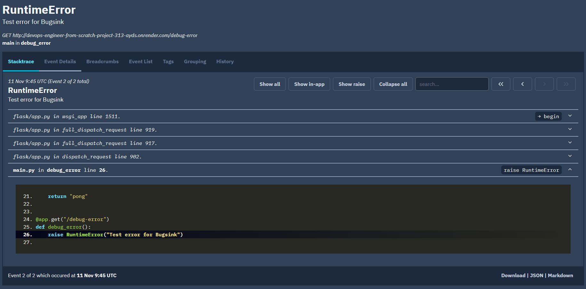

# Деплой приложения на PaaS (Devops)

[](https://github.com/whoYonica/devops-engineer-from-scratch-project-313/actions)


[](https://github.com/whoYonica/devops-engineer-from-scratch-project-313/actions/workflows/ci.yml)


Учебный проект Хекслета: https://ru.hexlet.io/programs/devops-engineer-from-scratch


## Развёрнутое приложение

Приложение доступно на Render:

https://devops-engineer-from-scratch-project-313-ayds.onrender.com

Сервис позволяет создавать, просматривать, редактировать
и удалять короткие ссылки через веб-интерфейс.

Данные хранятся в PostgreSQL.
Мониторинг ошибок реализован с помощью Bugsink.


## Стек

- Python
- Flask
- uv
- Make

## Установка

Склонируйте репозиторий:

```bash
git clone https://github.com/whoYonica/devops-engineer-from-scratch-project-313.git
cd devops-engineer-from-scratch-project-313
```

Установите зависимости с помощью uv:

```bash
uv sync
```

## Использование

Для запуска приложения выполните:

```bash
make run
```

Приложение запускается на порту 8080.

Проверить работу приложения можно командой:

```bash
curl http://localhost:8080/ping
```

Ожидаемый ответ:

```text
pong
```


### Пример создания короткой ссылки

Отправьте POST-запрос:

```bash
curl -X POST http://localhost:8080/api/links \
  -H "Content-Type: application/json" \
  -d '{"original_url":"https://github.com","short_name":"github"}'
```

После создания ссылка будет доступна по адресу:

http://localhost:8080/r/github


### Запуск приложения с интерфейсом

Установите зависимости фронтенда:

```bash
npm ci
```

Для локального запуска необходимо настроить переменную окружения `DATABASE_URL` в файле `.env`.

Запустите бэкенд и фронтенд одновременно:

```bash
make dev
```

После запуска приложение доступно по адресу:

http://localhost:5173

Flask API работает на порту 8080.

### Проверка приложения

Запустите тесты:

```bash
make test
```

Проверьте код линтером Ruff:

```bash
make lint
```


### Демонстрация работы

# Запуск приложения:
[](https://asciinema.org/a/C6Rsfs23kbpOh2bz)


## Мониторинг ошибок

---

<details>
<summary>Автоматические тесты Хекслета</summary>

Тесты запускаются на каждый коммит. За запуск отвечает файл `.github/workflows/hexlet-check.yml` — не удаляйте и не переименовывайте ни его, ни репозиторий.

</details>

## О Хекслете

[Хекслет](https://ru.hexlet.io/) — школа программирования: авторские программы обучения с практикой, поддержкой наставников и реальными проектами, которые остаются в резюме. Этот репозиторий — один из таких проектов.
