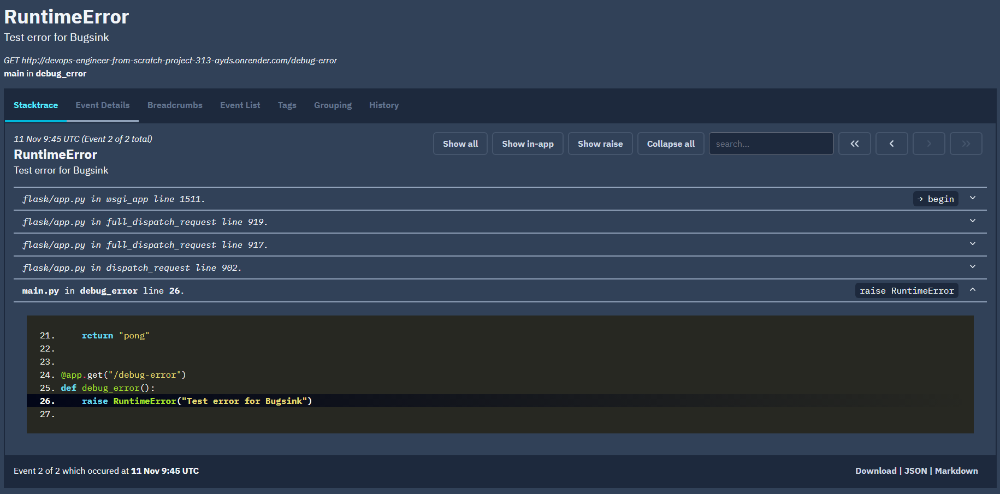

# Деплой приложения на PaaS (Devops)

[](https://github.com/whoYonica/devops-engineer-from-scratch-project-313/actions)


[](https://github.com/whoYonica/devops-engineer-from-scratch-project-313/actions/workflows/ci.yml)


Учебный проект Хекслета: https://ru.hexlet.io/programs/devops-engineer-from-scratch


## Стек

- Python
- Flask
- uv
- Make

## Установка

Склонируйте репозиторий:

```bash
git clone https://github.com/whoYonica/devops-engineer-from-scratch-project-313.git
cd devops-engineer-from-scratch-project-313
```

Установите зависимости с помощью uv:

```bash
uv sync
```

## Использование

Для запуска приложения выполните:

```bash
make run
```

Приложение запускается на порту 8080.

Проверить работу приложения можно командой:

```bash
curl http://localhost:8080/ping
```

Ожидаемый ответ:

```text
pong
```

### Демонстрация работы

# Запуск приложения:
[](https://asciinema.org/a/C6Rsfs23kbpOh2bz)

<!-- Добавьте примеры запуска и запись asciinema — именно это смотрит работодатель -->

## Мониторинг ошибок

---

<details>
<summary>Автоматические тесты Хекслета</summary>

Тесты запускаются на каждый коммит. За запуск отвечает файл `.github/workflows/hexlet-check.yml` — не удаляйте и не переименовывайте ни его, ни репозиторий.

</details>

## О Хекслете

[Хекслет](https://ru.hexlet.io/) — школа программирования: авторские программы обучения с практикой, поддержкой наставников и реальными проектами, которые остаются в резюме. Этот репозиторий — один из таких проектов.
